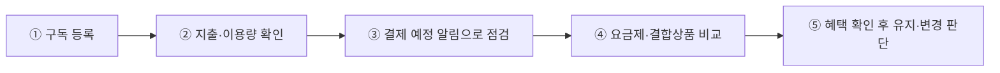

# SubscriptionGuard

### 구독을 잊지 않도록, 결제 전에 한 번 더 확인하세요.

**구독 관리 · 앱 이용량 확인 · 결제 예정일 사전 알림**

| 한눈에 보는 구독 | 이용 기록을 바탕으로 판단 | 결제 전 점검 | 조건에 맞는 절약 비교 | 혜택까지 확인 |
| :---: | :---: | :---: | :---: | :---: |
| 구독·지출 통합 관리 | 앱별 사용 분석 | 결제 예정 알림 | 요금제·구독 결합상품 | 멤버십·서비스 연동 |

## 🎬 데모 영상

> **▶ 시연 영상 예정**  

<!-- 영상 공개 후 아래 예시의 경로와 주소를 실제 값으로 바꾸고 주석을 해제하세요.

최종 썸네일과 영상이 준비되기 전에는 링크를 활성화하지 않습니다.
-->

## 💡 어떤 문제를 해결하나요?

- 여러 서비스에 흩어진 **구독료와 결제일**을 파악하기 어렵습니다.
- 결제는 계속되지만 **얼마나 이용하는지** 확인하기 어렵습니다.
- 통신사 결합상품과 멤버십 혜택을 각각 찾아보며 **더 유리한 선택**을 비교해야 합니다.

SubscriptionGuard는 **지출 → 이용 기록 → 결제 일정 → 절약 대안 → 혜택**을 연결해 구독을 유지하거나 조정할 때 필요한 판단을 돕습니다.

## ✨ 핵심 기능과 실제 화면

### 1. 구독 통합 관리

**등록한 구독과 월평균 지출, 다가오는 결제를 한눈에 확인합니다.** 서비스 선택부터 구독 정보 입력·수정·삭제까지 이어지는 관리 흐름을 제공합니다.

<table>
  <tr>
    <th>홈 · 구독 현황</th>
    <th>구독 추가 · 서비스 선택</th>
  </tr>
  <tr>
    <td align="center"></td>
    <td align="center"></td>
  </tr>
</table>

월평균·연간 환산 비용은 등록한 결제액과 결제 주기를 바탕으로 계산하는 참고값입니다. 실제 월별 청구액과 다를 수 있습니다.

### 2. 이용량 분석

**연결한 앱의 최근 사용 기록으로 구독 활용도를 살펴봅니다.** 기간별 합계와 일별 기록을 확인해 구독 유지 여부를 판단할 수 있습니다.

  

캡처에는 **7일·30일 선택 화면**이 있습니다. 확인한 `main` 코드는 **최근 7일 전면 사용 기록**을 다루며, 30일 조회의 통합 여부는 추가 확인이 필요합니다. 전면 사용 시간은 실제 콘텐츠 소비량과 다르고, 백그라운드 재생·다른 기기에서의 이용을 모두 포함하지 않습니다.

### 3. 결제 예정 알림

**등록한 결제 예정일을 기준으로 다음 결제 전에 구독을 점검하도록 안내합니다.** 결제 3일 전·1일 전·당일의 알림 판단과 표시 요청 코드가 확인됩니다.

  

위 이미지는 **알림 설정·테스트 화면**입니다. 실제 알림 수신 화면은 시연 검증 후 추가할 예정입니다. 실제 청구 여부를 감지하는 기능은 확인되지 않았으며, Android 백그라운드 정책에 따라 알림이 늦거나 누락될 수 있습니다.

### 4. 요금제·구독 결합상품 절약 추천

**각각 결제 중인 구독과 통신사·결합 조건을 비교해 절약 후보를 보여줍니다.** 후보 순위, 가입 조건, 비교 가능한 경우의 예상 월 절감액을 함께 제시하는 화면이 핵심입니다.

<table>
  <tr>
    <th>KT 결합 후보</th>
    <th>SKT 결합 후보</th>
    <th>LG U+ 제공 상품</th>
  </tr>
  <tr>
    <td align="center"></td>
    <td align="center"></td>
    <td align="center"></td>
  </tr>
</table>

제공된 화면은 관측된 앱 사용 기록과 통신사·가격 정보 등을 반영하는 후보 순위를 설명합니다. **실제 추천 로직, 계산 결과와 화면의 연결은 통합 검증이 필요합니다.** 가격이나 결합 조건이 부족한 경우에는 절감액 확정 대신 추가 확인을 안내합니다.

화면의 절감액은 테스트 입력값을 사용한 시연 결과로, 실제 절감 실적이나 누구에게나 적용되는 금액이 아닙니다. 요금제 등급·기존 할인·추가 요금·약정 조건을 확인한 뒤 비교해야 합니다. AI 기반 개인화 추천의 구현 여부는 아직 확인하지 않았습니다.

### 5. 멤버십 혜택 및 서비스 연동

**구독료뿐 아니라 이용 기간 동안 받은 혜택과 연결 서비스의 사용 현황도 함께 확인합니다.** 네이버플러스·쿠팡 와우의 기간별 혜택, MYBOX 저장공간 등 서비스별 화면이 제공되어 있습니다.

<table>
  <tr>
    <th>네이버플러스 · 적립 혜택</th>
    <th>쿠팡 와우 · 혜택 비교</th>
    <th>MYBOX · 저장공간</th>
  </tr>
  <tr>
    <td align="center"></td>
    <td align="center"></td>
    <td align="center"></td>
  </tr>
</table>

**알림에서 확인한 기록과 사용자가 직접 입력한 기간 합계는 구분합니다.** 알림 관측은 누락될 수 있으며, 화면에 표시된 연동만으로 전체 주문·적립 내역이 자동 수집된다고 보장하지 않습니다. 실제 계정 연결·갱신과 알림 기반 집계는 실기기 확인 대상입니다.

## 🧭 핵심 사용자 여정

1. **등록:** 이용 중인 서비스를 선택하고 결제액·주기·다음 결제일을 입력합니다.
2. **확인:** 홈에서 지출을 파악하고 연결 앱의 이용 기록을 살펴봅니다.
3. **점검:** 결제 예정 알림을 통해 다음 결제 전에 구독을 검토합니다.
4. **비교:** 통신사·요금제·결합 조건을 확인하고 절약 후보를 비교합니다.
5. **판단:** 멤버십 혜택까지 확인해 구독 유지·조정 여부를 결정합니다.

이 여정은 화면을 중심으로 정리한 목표 흐름입니다. 전체 흐름이 한 빌드에서 이어지는지는 최종 시연으로 검증할 예정입니다.

## 🛠 기술 스택

| 영역 | 기술 | 사용 목적 · 확인 범위 |
| --- | --- | --- |
| 플랫폼·언어 | Android · Kotlin | Android 앱 개발 |
| 화면 | Jetpack Compose · Material 3 | 선언형 UI 구성 |
| 로컬 저장 | Jetpack DataStore Preferences | 구독 정보·설정·알림 처리 기록 보관 |
| 비동기 처리 | Kotlin Coroutines · Flow | 데이터 조회와 상태 반영 |
| 이용 기록 | Android UsageStatsManager | 권한을 허용한 기기의 전면 앱 사용 기록 조회 |
| 백그라운드 작업 | Android WorkManager | 결제 예정 알림 확인 작업 예약 |
| 알림 | Android Notification API · AndroidX Core | 알림 채널·권한 확인 및 표시 요청 |

위 기술은 확인한 `main` 소스와 앱 의존성 설정을 기준으로 정리했습니다. 추천 엔진·AI·외부 서비스 연동의 기술 구성과 버전은 팀원 확인 후 보완합니다.

## 구현 상태와 검증 필요사항

**확인 기준: 2026-11-26.** 제공된 앱 화면과 팀원 협의 내용을 검토하고, 저장소 `main`의 구독 관리·사용 기록·요금제 입력 코드 및 의존성 설정을 확인했습니다. 이번 문서 작업에서는 앱 빌드나 실기기 테스트를 수행하지 않았습니다.

| 기능 축 | 현재 확인한 범위 | 검증·보완할 사항 |
| --- | --- | --- |
| 구독 통합 관리 | **코드·화면 확인:** 등록·수정·삭제, 비용 환산, 홈·서비스 선택 화면 | 최종 UI와 저장 코드의 연결, 재실행 후 데이터 유지 |
| 이용량 분석 | **코드·화면 확인:** 최근 7일 전면 사용 기록 / **화면 확인:** 30일 선택 | 30일 조회 통합, 권한 없음·기록 없음·조회 실패 표시, 백그라운드 재생 집계 범위 |
| 결제 예정 알림 | **제공 코드 확인:** 3일 전·1일 전·당일 판단, 작업 예약·표시 요청 / **화면 확인:** 설정·테스트 | 실제 수신, 중복 방지, 결제일 수정·구독 삭제 후 반영 |
| 절약 추천 | **화면 확인:** 통신사별 후보·순위·조건·예상 절감액 / **코드 확인:** 통신사·요금제 입력·저장 | 추천 로직 통합, 등급·할인·약정 반영, 비교 비용·절감액 산식과 가격 기준일 |
| 멤버십·연동 | **화면 확인:** 기간별 혜택, 알림 집계 설정, MYBOX 용량 | 실제 주문·적립 알림 집계, 계정 연결·갱신, 수동 입력·자동 기록 중복 처리 |
| 확장 아이디어 | **팀 협의:** 미등록 구독 찾기·결제 알림 기반 등록 보조·AI 활용 방향 | 구현 여부와 최종 제공 범위 확정 |

**상태 표기:** ‘코드 확인’은 관련 구현의 존재, ‘화면 확인’은 UI 표시를 뜻합니다. 어느 쪽도 최종 통합 동작이나 테스트 통과를 의미하지 않습니다.

팀원 논의 후 채울 세부 기능 명세

| 기능 축 | 합의할 내용 | 담당 · 확인 결과 |
| --- | --- | --- |
| 구독 통합 관리 | 지원 서비스·입력 항목·갱신 정책, 결제 달력 범위 | 추후 작성 |
| 이용량 분석 | 서비스별 측정 기준, 7일·30일과 백그라운드 재생 범위 | 추후 작성 |
| 결제 예정 알림 | 알림 정책, 수정·삭제·권한 변경 후 처리 | 추후 작성 |
| 절약 추천 | 순위 기준, 비용 비교 범위, 상품 정보 갱신 기준 | 추후 작성 |
| 멤버십·연동 | 수집 대상·권한·계정 연결·수동 입력·중복 처리 | 추후 작성 |

세부 입력·처리·예외 명세는 팀원 합의 후 별도 문서로 연결할 예정입니다. 이 README에는 핵심 가치와 화면 중심 설명을 유지합니다.

시연·제출 전 확인할 항목

- [ ] 최종 시연 빌드·브랜치와 캡처 버전 일치 확인
- [ ] 실제 상품 조건에 맞는 시연 데이터로 교체하고 절감액 계산 검증
- [ ] 데모 영상·썸네일 삽입 및 실제 알림 수신 장면 추가
- [ ] 사용 기록·알림·알림 접근 권한을 기능별로 확인
- [ ] 쿠팡 주문·네이버 적립의 실제 알림 집계, MYBOX 실제 계정 조회·갱신 검증
- [ ] Spotify·밀리의서재 등 화면을 끈 상태의 재생 시간·일시정지 처리 확인
- [ ] 결제일 변경·구독 삭제 후 알림 동작과 재실행 후 저장 확인
- [ ] 프로젝트명 확정: 기존 초안은 SubscriptionGuard, 확인한 코드·팀 대화는 SubOptimizer 사용
- [ ] 팀원·담당 역할·시연 설치 파일·실행 환경 추가

검토 자료와 이미지 안내

- 기존 `SubscriptionGuard_README_draft.md`에 관해 이전 대화에 남은 초안 미리보기
- 사용자 첨부 10개 자료: 앱 화면 모음, 팀원 카카오톡 협의, 화면 구성·기능 검증 메모
- [앱 의존성 설정](https://github.com/haedal-hackaton/subscription-optimizer/blob/main/app/build.gradle.kts) · [확인한 소스 폴더](https://github.com/haedal-hackaton/subscription-optimizer/tree/main/app/src/main/java/com/example/suboptimizer)
- 이미지는 제공된 앱 화면 모음에서 개별 화면을 분리했습니다. 화면의 문구·수치를 수정하지 않았습니다.
- 카카오톡 원문과 개인 계정 정보는 README 이미지에 포함하지 않았습니다.
- 이미지 경로를 유지하려면 이 문서와 `assets/readme/` 폴더를 함께 저장소에 추가하세요.

