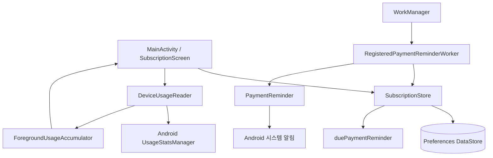

# SubscriptionGuard

### 구독을 잊지 않도록, 결제 전에 한 번 더 확인하세요.

**구독 관리 · 앱 이용량 확인 · 결제 예정일 사전 알림**

`Android` · `Kotlin` · `Jetpack Compose`

---

## 🎬 앱 시연 영상

> **시연 영상 추가 예정** — 최종 시연 영상을 업로드한 뒤, 이 위치에 영상 썸네일과 재생 링크를 배치합니다.

<!-- 영상 업로드 후 아래 예시의 주석을 해제하고 실제 주소로 교체하세요.

-->

## 💡 왜 만들었나요?

사용하지 않는 구독 서비스를 계속 결제하거나, 자동 갱신일을 놓쳐 원하지 않는 결제를 경험할 수 있습니다. 하지만 구독료, 결제 예정일, 실제 앱 이용 기록은 서로 다른 곳에 흩어져 있습니다.

**SubscriptionGuard**는 이 정보를 한곳에서 확인해 사용자가 **구독 유지 여부를 스스로 판단**하도록 돕는 Android 앱입니다.

> **핵심 목표:** 이미 결제된 뒤 후회하기보다, 결제 전에 알아차리고 선택할 수 있도록 돕기.

## ✨ 핵심 기능

| 기능 | 사용자에게 제공하는 가치 |
| --- | --- |
| 💳 **구독 통합 관리** | 구독 등록·수정·삭제, 결제일 확인, 월평균·연간 지출 환산 |
| 📊 **앱 이용량 확인** | 연결한 앱의 최근 7일 전면 사용 시간과 날짜별 기록 확인 |
| 🔔 **결제 예정일 알림** | 등록된 결제일 **3일 전·1일 전·당일** 알림 대상 확인 및 발송 요청 |
| 📱 **통신사·요금제 화면** | 통신사·요금제 관리 화면으로 이동 |

### 1. 구독 관리 및 지출 현황

서비스명, 실제 결제 금액, 월간·연간 결제 주기, 다음 결제 예정일을 직접 등록합니다. 등록된 구독은 수정·삭제할 수 있고, 전체 구독료를 **월평균 지출**과 **연간 환산 지출**로 보여줍니다.

- 월간 결제: `월 결제 금액 × 12`로 연간 환산
- 연간 결제: 등록된 `1년 결제 금액`을 그대로 사용
- 월평균 지출: 연간 환산 지출 합계를 12로 나누고 원 단위 반올림
- 결제일: 오늘 기준 남은 일수 또는 지난 일수 표시

<!-- TODO: 실제 '구독 등록' / '구독 목록·비용 합계' 화면 캡처 추가 -->

### 2. 최근 7일 앱 이용량

사용자가 등록한 구독에 Android 앱을 연결하면 해당 앱의 **최근 7개 날짜(오늘 포함)** 전면 사용 시간을 확인할 수 있습니다. 오늘의 기록은 조회 시점까지의 부분 데이터입니다.

- 연결 선택지: YouTube, Netflix, TVING, Spotify, ChatGPT 또는 연결하지 않음
- Android `UsageStatsManager`의 활동 이벤트를 기반으로 전면 사용 시간을 집계
- 자정을 넘는 사용 구간은 날짜별로 나누어 합산
- 메인 화면에서는 당일 사용 앱을 사용 시간이 긴 순서로 표시

<!-- TODO: 실제 '사용 기록 조회' / '최근 7일 이용량' 화면 캡처 추가 -->

### 3. 결제 예정일 사전 알림

등록한 결제 예정일의 **3일 전·1일 전·당일**에 알림 대상 여부를 확인합니다. Android `WorkManager`로 **1시간 간격의 주기적 확인 작업을 예약**하며, 구독 정보 변경 등에 따라 추가 확인 작업도 요청합니다.

- 서비스명과 결제 예정일이 포함된 시스템 알림 표시 요청
- 구독 ID·결제일·알림 단계별 식별자로 중복 처리 관리
- 알림 권한 및 알림 채널 차단 상태 확인
- 테스트 알림 제공, 알림 탭 시 앱 메인 화면으로 이동

> **유의:** 1시간은 작업 예약 주기이지 정확한 알림 발송 시각이 아닙니다. Android의 실행 제한에 따라 알림이 지연되거나 누락될 수 있습니다.

<!-- TODO: 실제 '결제 안내 알림' 캡처 추가 -->

---

## 🧭 사용자 이용 흐름

1. **구독 등록** — 서비스명, 결제 금액, 결제 주기, 다음 결제일 입력
2. **앱 연결** — 필요하면 구독과 Android 앱의 패키지명 연결
3. **이용량 확인** — 최근 7일의 앱별 전면 사용 기록 확인
4. **지출 확인** — 월평균·연간 환산 구독료와 결제 예정일까지 남은 일수 확인
5. **결제 전 재검토** — 결제 예정 알림을 참고해 유지·변경·해지를 사용자가 직접 결정

> 앱에서 구독 정보를 삭제해도 **외부 서비스의 실제 정기결제는 해지되지 않습니다.**

## 📋 상세 기능 명세

### F-01. 구독 정보 관리 및 비용 환산

| 항목 | 명세 |
| --- | --- |
| **입력** | 서비스명, 결제 금액(원 단위 정수), 결제 주기(월간/연간), 다음 결제일(`YYYY-MM-DD`), 연결 앱(선택) |
| **검증** | 빈 서비스명, 0원 이하 금액, 유효하지 않은 날짜 입력 차단 |
| **처리** | 고유 ID 기반 추가·조회·수정·삭제; 월간/연간 금액을 연간 기준으로 환산 |
| **저장** | `Preferences DataStore`에 JSON 문자열로 저장; 변경 사항은 `Flow`로 전달 |
| **출력** | 구독 목록, 등록된 결제 정보, 결제일까지 남은 일수, 월평균 및 연간 환산 지출 |
| **예외 및 제약** | 저장 실패·데이터 형식 오류 안내; 실제 결제 내역 자동 조회 및 외부 서비스 해지는 지원하지 않음 |
| **관련 코드** | `subscriptionStore.kt`, `subsriptionScreen.kt` |

### F-02. Android 앱 사용 기록 조회 및 일별 집계

| 항목 | 명세 |
| --- | --- |
| **입력** | Android 사용 이벤트, 앱 패키지명, 조회 시점 및 기기 시간대 |
| **권한** | Android '사용 정보 접근' 허용 필요 |
| **수집** | `UsageStatsManager.queryEvents()`로 활동 활성화/중단 및 화면 비활성화 이벤트 조회 |
| **처리** | `ForegroundUsageAccumulator`로 전면 사용 구간 계산, 날짜 경계에 따라 일별 합산 |
| **범위** | 오늘을 포함한 최근 7개 달력 날짜; 오늘은 부분 데이터 |
| **출력** | 당일 사용 앱 목록, 연결 앱의 최근 7일 합계와 날짜별 전면 사용 시간 |
| **예외 및 제약** | 권한 거부·조회 실패·기록 누락 안내; 백그라운드 재생, TV·PC 이용, 유료 가입 여부는 측정하지 않음 |
| **관련 코드** | `DeviceUsageReader.kt`, `ForegroundUsage.kt`, `MainActivity.kt`, `subsriptionScreen.kt` |

### F-03. 결제 예정일 사전 알림

| 항목 | 명세 |
| --- | --- |
| **입력** | 등록 구독의 다음 결제일, 현재 날짜, 알림 처리 기록 |
| **판정** | 결제일까지 남은 일수가 `3`, `1`, `0`인 경우에만 알림 대상 |
| **실행 예약** | `WorkManager`의 1시간 간격 주기적 작업 및 필요 시 일회성 작업 |
| **중복 관리** | `구독 ID / 결제일 / 알림 단계` 키를 DataStore에 기록하여 동일 단계 중복 처리 감소 |
| **출력** | 서비스명·결제 예정일·알림 단계가 포함된 Android 시스템 알림 표시 요청 |
| **예외 및 제약** | 알림 권한·채널 차단 확인, 일부 실패 시 재시도; 정확한 발송 시각·실제 청구 여부 확인은 보장하지 않음 |
| **관련 코드** | `RegisteredPaymentReminder.kt`, `RegisteredPaymentReminderWorker.kt`, `PaymentReminder.kt`, `subscriptionStore.kt` |

---

## 🏗️ 기술 스택과 구조

| 영역 | 기술 | 용도 |
| --- | --- | --- |
| 언어 | **Kotlin** | Android 애플리케이션 개발 |
| UI | **Jetpack Compose / Material 3** | 메인 화면, 구독 관리 화면 |
| 로컬 저장 | **Android Preferences DataStore** | 구독 목록 및 알림 처리 기록 저장 |
| 비동기 처리 | **Kotlin Coroutines / Flow** | 기록 조회, 데이터 변경 감지 |
| 이용량 수집 | **UsageStatsManager / UsageEvents** | 앱 활동 이벤트 조회 |
| 백그라운드 | **WorkManager** | 결제 예정 알림 확인 작업 예약 |
| 알림 | **NotificationCompat / NotificationChannel** | 시스템 알림 표시 및 관리 |

## 🚀 실행 및 권한 안내

1. 저장소를 내려받아 **Android Studio**에서 Android 프로젝트를 엽니다.
2. Gradle 동기화 후 Android 기기 또는 에뮬레이터에서 실행합니다.
3. **사용 정보 접근** 설정에서 앱의 사용 기록 접근을 허용하면 이용량을 확인할 수 있습니다.
4. **알림 권한**과 **'구독 결제 안내' 채널**을 허용하면 결제 예정 알림을 사용할 수 있습니다.

> 정확한 최소 Android 버전, 빌드 요구 사항 및 테스트 환경은 `app/build.gradle.kts`, `AndroidManifest.xml`과 실제 실행 결과를 확인한 뒤 보완할 예정입니다.

## ⚠️ 데이터 해석 및 서비스 한계

- **수동 등록 기반:** 앱 사용 기록만으로 유료 구독 가입 여부나 실제 결제 내역을 확인하지 않습니다.
- **이용량 범위:** 현재 확인된 기본 구현은 **최근 7일의 해당 Android 기기 전면 사용 시간**을 집계합니다. 타 기기·백그라운드 이용량은 포함되지 않을 수 있습니다.
- **기록의 불완전성:** Android 이벤트 보존 기간, 누락, 다중 창 등에 따라 이용량이 실제와 다를 수 있습니다. '조회된 기록 없음'은 '미사용'과 다릅니다.
- **지출의 의미:** 월평균 및 연간 지출은 사용자가 등록한 금액의 환산값으로, 실제 카드 청구 내역과 다를 수 있습니다.
- **알림의 정확성:** WorkManager는 정확한 시각에 알림이 실행된다고 보장하지 않습니다. 이미 지난 알림 단계는 소급 발송하지 않습니다.
- **정기결제 관리 범위:** 앱에 저장된 구독을 삭제해도 실제 서비스는 해지되지 않습니다. 다음 결제일의 자동 월별 갱신은 현재 확인한 코드에서 발견되지 않았습니다.

## 🗺️ 개발 현황 및 향후 계획

| 항목 | 상태 | 비고 |
| --- | --- | --- |
| 구독 등록·수정·삭제 및 비용 환산 | 소스 코드 확인 | 실제 기기 검증 결과 추가 예정 |
| 최근 7일 Android 전면 사용량 | 소스 코드 확인 | 정확도 및 권한별 시나리오 테스트 예정 |
| 결제 사전 알림 | 소스 코드 확인 | 알림 지연·누락 등 단말 테스트 예정 |
| 통신사·요금제 관리 | 세부 분석 필요 | `MobilePlan*` 소스 확인 예정 |
| AI 기반 개인화 분석 | 브랜치 통합 여부 확인 필요 | 메인 브랜치 구현 여부 미확정 |
| 구독·통신 요금 최적 조합 추천 | 브랜치 통합 여부 확인 필요 | 추천 조건 및 실제 동작 검증 예정 |

## 👥 팀원 및 역할

> **작성 예정** — 팀원 이름, 담당 기능, GitHub 프로필 링크를 최종 제출 전에 추가합니다.

## 📌 문서 기준

이 README 초안은 다음 8개 Kotlin 파일의 공유된 소스를 기준으로 작성했습니다.

`MainActivity.kt` · `subscriptionStore.kt` · `subsriptionScreen.kt` · `DeviceUsageReader.kt` · `ForegroundUsage.kt` · `RegisteredPaymentReminder.kt` · `RegisteredPaymentReminderWorker.kt` · `PaymentReminder.kt`

**실제 UI 이미지, 앱 시연 영상, 통신사 및 추천 기능의 상세 명세, 테스트 결과는 추가 검증 후 업데이트해야 합니다.**
