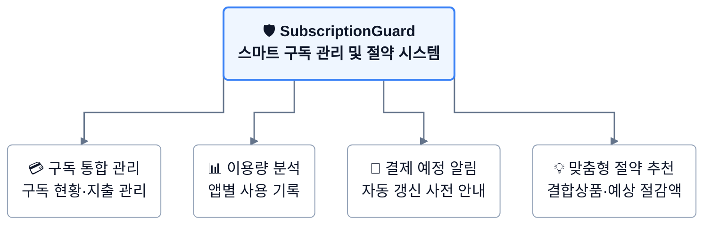

**구독 관리 · 앱 이용량 확인 · 결제 예정일 사전 알림 · 맞춤 상품 추천**

이미 결제된 뒤 후회하기보다, 결제 전에 알아차리고 선택하자

## 🎬 데모 영상

> **▶ 시연 영상 예정**  

<!-- 영상 공개 후 아래 예시의 경로와 주소를 실제 값으로 바꾸고 주석을 해제하세요.

최종 썸네일과 영상이 준비되기 전에는 링크를 활성화하지 않습니다.
-->

## 💡 어떤 불편함이 있을까요?

- 흩어져 있는 **구독서비스를 하나하나**을 파악하지 못할 수 있습니다.
- 결제는 계속되지만 **얼마나 이용하는지** 확인하기 어려울 수 있습니다.
- 통신사 결합상품과 멤버십 혜택을 찾아보며 **유리한 혜택**을 비교하는데 불편함이 있을 수 있습니다.

**SubscriptionGuard**는 **지출 → 이용 기록 → 결제 일정 → 절약 대안 → 혜택**을 연결해서 구독을 유지하거나 해지할 수 있도록 돕습니다.

## ✨ 핵심 기능

    
| 기능 | 주요 내용 |
| --- | --- |
| 💳 **구독 통합 관리** | 흩어진 구독을 등록하고, 구독료·결제일·월평균 지출을 한눈에 확인합니다. |
| 📊 **이용량 분석** | 앱별 사용 시간과 일별 기록을 확인해 구독을 얼마나 활용하는지 점검합니다. |
| 🔔 **결제 예정 알림** | 다음 결제 전에 알림을 받아 구독 유지 여부를 미리 판단합니다. |
| 💡 **맞춤형 절약 추천** | 통신사·요금제·구독 조건에 맞는 결합상품을 비교하고 예상 절감액을 확인합니다. |

## 💻 시스템 구조

## 🛠 기술 스택

| 구분 | 기술 | 주요 용도 |
| --- | --- | --- |
| Android / Language | **Kotlin** | Android 애플리케이션 개발 |
| UI | **Jetpack Compose · Material 3** | 화면 및 UI 컴포넌트 |
| Local Storage | **Preferences DataStore** | 구독 및 알림 처리 기록 저장 |
| Async / Reactive | **Kotlin Coroutines · Flow** | 비동기 작업과 데이터 변경 반영 |
| Usage Analytics | **UsageStatsManager · UsageEvents** | 기기 앱 활동 기록 조회 |
| Background Task | **WorkManager** | 결제 예정 알림 확인 |
| Notification | **NotificationCompat · NotificationChannel** | 시스템 알림 표시 |
| Product Information | **Jsoup** (추천 기능 브랜치) | 공식 상품 페이지 정보 확인 |
| Build | **Gradle · Kotlin DSL** | 빌드 및 의존성 관리 |

## 👥 팀원 및 역할
- **김백솔** - 
- **박현우** -
- **이준현** - 
- **윤은식** 
