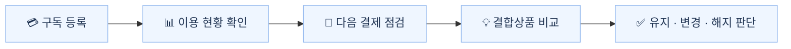
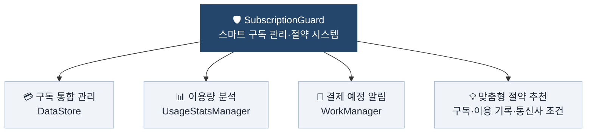

<p align="center">
  
</p>

<h1 align="center">🛡️ SubscriptionGuard</h1>
<p align="center"><strong>결제 전에 한 번 더. 나의 지갑을 지켜줄 지갑이.</strong></p>
<p align="center">구독의 후회를 줄이는 스마트 구독 관리 및 절약 지원 Android 앱</p>
<p align="center"><code>Kotlin</code> · <code>Jetpack Compose</code> · <code>DataStore</code> · <code>WorkManager</code></p>

---

## 🎬 시연 영상

> **데모 영상 준비 중** — 최종 시연 영상이 업로드되면 이 영역에 썸네일과 재생 링크를 연결합니다.

<!-- 아래 주소를 실제 영상 URL로 교체한 뒤 주석을 해제하세요.
[](https://실제-시연-영상-주소)
-->

## 💡 왜 만들었나요?

구독 서비스는 가입하기 쉽지만, **어떤 서비스에 얼마를 내고 있는지**, **얼마나 이용하고 있는지**, **언제 다시 결제되는지** 기억하고 관리하기는 어렵습니다. 해지하려던 구독이 자동 갱신된 뒤 후회하거나, 통신사 결합상품과 멤버십 혜택을 비교하지 못한 채 개별 결제를 유지할 수도 있습니다.

**SubscriptionGuard**는 흩어진 **구독 정보 → 이용 기록 → 결제 일정 → 절약 대안**을 하나의 흐름으로 연결합니다.

> **우리가 해결하고 싶은 문제:** 이미 결제된 뒤 후회하기보다, 다음 결제 전에 알아차리고 **유지·변경·해지 여부를 스스로 결정**하도록 돕는 것.

## ✨ 핵심 기능

| 기능 | 사용자에게 제공하는 가치 |
| --- | --- |
| 💳 **구독 통합 관리** | 등록한 구독과 월평균 지출, 다음 결제일을 한눈에 확인합니다. |
| 📊 **이용량 분석** | 앱 사용 기록과 서비스별로 확인 가능한 이용 지표를 점검합니다. |
| 🔔 **결제 예정 알림** | 결제 **3일 전·1일 전·당일**에 갱신 예정 정보를 알려줍니다. |
| 💡 **맞춤형 절약 추천** | 등록한 구독과 통신사 조건을 반영해 결합상품 후보 및 예상 비용을 비교합니다. |

### 앱 화면 미리보기

| 구독 현황 | 이용량 분석 | 구독 서비스 선택 |
| :---: | :---: | :---: |
|  |  |  |

| 결제 알림 설정 | 결합상품 추천 | MYBOX 연동 |
| :---: | :---: | :---: |
|  |  |  |

<sub>※ 캡처의 구독 금액·서비스명·사용 기록 중 일부는 **시연용 입력값**입니다. 실제 사용자 지출 통계나 보장된 절감액이 아닙니다.</sub>

### 💳 01. 구독 통합 관리

여러 서비스의 구독 정보를 직접 등록하고, **결제 금액·주기·다음 결제일**을 한곳에서 관리합니다. 월간·연간 결제를 월평균 지출로 환산해 전체 구독 비용을 쉽게 파악할 수 있도록 돕습니다.

### 📊 02. 이용량 분석

Android 기기에 기록된 앱 사용 이벤트를 기반으로 **앱별 전면 사용 시간**과 **일별 기록**을 확인합니다. 기본 소스에서는 최근 7일 분석을 확인했으며, 확장 브랜치에는 7일·30일 선택과 서비스별 추가 이용 기록 화면이 포함되어 있습니다.

서비스마다 이용 방식이 다르다는 점도 고려합니다. 영상은 앱 사용 기록, 음악은 확인 가능한 재생 이력, 쇼핑 멤버십은 주문·적립 기록, 클라우드는 저장 용량 등으로 점검 범위를 확장하고 있습니다.

### 🔔 03. 결제 예정 알림

등록한 결제 예정일을 기준으로 **3일 전·1일 전·당일** 안내를 요청합니다. WorkManager가 백그라운드에서 결제 예정 구독을 확인하고, 같은 결제일과 알림 단계의 중복 요청을 줄이도록 처리합니다.

> 정해진 날짜에 대한 **안내**이며, 금융기관에서 실제 청구 여부를 확인하거나 정확한 시각에 알림을 보장하는 기능은 아닙니다.

### 💡 04. 맞춤형 절약 추천

사용자가 등록한 구독 조합, 연결된 앱의 최근 이용 기록, 통신사·요금제 조건 등을 고려해 **결합상품 추천 후보**를 정렬합니다. 조건이 충족되는 경우 **현재 개별 구독 비용과 결합 후 예상 월 비용**을 비교할 수 있습니다.

- **서비스 조합 매칭:** 등록한 서비스가 포함된 결합상품을 후보로 선정
- **이용 현황 반영:** 관측된 서비스 수와 이용일 수 등을 반영해 후보 정렬
- **조건부 금액 비교:** 확인 가능한 가격·등급·요금제 정보를 바탕으로 예상 월 차이 표시
- **공식 정보 안내:** 가입 조건을 검토할 수 있는 상품 안내 페이지로 연결

**추천은 단순 최저가순이나 AI 예측 결과가 아니라 규칙 기반 후보 정렬**입니다. 실제 가입 가능 여부, 위약금, 할인 조건, 최종 청구액은 통신사 공식 안내에서 확인해야 합니다.

### 🎁 서비스별 혜택 점검 (확장 기능)

`feature/optimization` 브랜치에는 **쿠팡 와우 주문 기록, 네이버플러스 적립·혜택, MYBOX 저장공간, 일부 오디오 재생 이력**을 확인하는 기능 코드와 화면이 포함되어 있습니다.

| 쇼핑·멤버십 혜택 | 쇼핑 주문 기록 |
| :---: | :---: |
|  |  |

이 기능들은 서비스별 접근 권한 및 기록 수집 범위가 다르므로, **최종 브랜치 통합과 실제 기기 검증 결과**에 맞춰 시연 범위를 확정합니다.

---

## 🧭 사용 흐름



**예시 시나리오:** Netflix와 YouTube Premium을 각각 구독하던 사용자가 다음 결제일과 최근 이용 현황을 확인한 뒤, 통신사 결합상품으로 변경할 때의 비용을 비교하고 유지·변경·해지 여부를 결정합니다.

## 💻 시스템 구조

복잡한 내부 클래스 대신, 앱의 주요 기능과 핵심 Android 구성 요소를 중심으로 정리했습니다.



주요 기능은 Kotlin 클래스로 역할을 나눠 구현했습니다. **구독 정보와 알림 처리 기록**은 Preferences DataStore에 저장하고, **사용 기록**은 Android의 UsageStatsManager를 통해 조회합니다. **결제 알림**은 WorkManager와 Android 알림 시스템을 활용합니다. **절약 추천**에는 등록 구독과 이용 기록, 상품 조건을 활용하는 규칙 기반 로직이 사용됩니다.

## 🛠 기술 스택

| 구분 | 기술 | 주요 용도 |
| --- | --- | --- |
| Android / Language | **Kotlin** | Android 애플리케이션 개발 |
| UI | **Jetpack Compose · Material 3** | 화면 및 UI 컴포넌트 |
| Local Storage | **Preferences DataStore** | 구독 및 알림 처리 기록 저장 |
| Async / Reactive | **Kotlin Coroutines · Flow** | 비동기 작업과 데이터 변경 반영 |
| Usage Analytics | **UsageStatsManager · UsageEvents** | 기기 앱 활동 기록 조회 |
| Background Task | **WorkManager** | 결제 예정 알림 확인 |
| Notification | **NotificationCompat · NotificationChannel** | 시스템 알림 표시 |
| Product Information | **Jsoup** (추천 기능 브랜치) | 공식 상품 페이지 정보 확인 |
| Build | **Gradle · Kotlin DSL** | 빌드 및 의존성 관리 |

## 🚀 실행 방법

### 1. 프로젝트 내려받기

```bash
git clone https://github.com/haedal-hackaton/subscription-optimizer.git
```

저장소가 비공개 상태라면 접근 권한이 있는 GitHub 계정으로 인증해야 합니다.

### 2. Android Studio에서 실행

프로젝트 폴더를 Android Studio에서 열고 **Gradle Sync**를 완료한 뒤, 연결된 Android 기기 또는 에뮬레이터에서 앱을 실행합니다.

- **최소 지원 버전:** Android 8.0 / API 26 (`minSdk = 26`)
- **컴파일·타깃 SDK 설정:** API 37 (확인한 `app/build.gradle.kts` 기준)
- 일부 외부 서비스 연동 기능은 별도의 계정 연결이나 권한 설정이 필요할 수 있습니다.

### 3. Android 권한 허용

| 권한 | 필요한 기능 | 설정 방식 |
| --- | --- | --- |
| **사용 정보 접근** (`PACKAGE_USAGE_STATS`) | 앱별 이용 기록 분석 | 기기 설정에서 별도로 허용 |
| **알림** (`POST_NOTIFICATIONS`) | 결제 예정 알림 | Android 13 이상에서 알림 권한 허용 |

권한이 없어도 수동 구독 등록 등 일부 기능은 사용할 수 있지만, 이용량 조회·알림 표시 기능은 제한됩니다.

## ⚠️ 데이터와 결과 해석 시 유의사항

- **사용자 입력 기반:** 구독 금액과 다음 결제일은 사용자가 등록한 값입니다. 실제 카드 승인·청구 내역을 자동 확인하는 기능이 아닙니다.
- **기록의 범위:** Android 앱 전면 사용 시간은 서비스 전체 사용량과 동일하지 않습니다. 타 기기 사용, 백그라운드 재생, 기록 누락이 반영되지 않을 수 있습니다.
- **비용 비교의 범위:** 추천 금액은 확인 가능한 상품 정보와 입력 조건을 기반으로 계산한 참고값입니다. 위약금이나 개인별 추가 할인 등은 반영되지 않을 수 있습니다.
- **실제 해지와 구분:** 앱에서 구독을 삭제해도 외부 서비스의 정기결제가 자동 해지되지는 않습니다.
- **알림 시각:** 백그라운드 작업은 Android 운영체제 정책에 따라 지연될 수 있습니다.

## 🚧 개발 현황

| 영역 | 확인한 범위 | 최종 확인할 내용 |
| --- | --- | --- |
| 구독 등록·저장·수정·삭제 | 기본 Kotlin 소스 확인 | 최종 통합본 동작 점검 |
| 최근 7일 앱 이용 기록 | 기본 Kotlin 소스 확인 | 권한·기기별 조회 결과 |
| 결제 3일·1일·당일 안내 | 기본 Kotlin 소스 확인 | 단말별 알림 수신 검증 |
| 7일·30일 및 서비스별 상세 이용 기록 | 기능 브랜치의 화면·관련 파일 확인 | 서비스별 기록 수집 범위 |
| 통신사 결합상품 및 예상 비용 비교 | `feature/optimization` 추천 로직 확인 | 공식 정보·실제 조건·브랜치 통합 |
| 쇼핑 혜택·MYBOX 등 연동 | 기능 브랜치의 화면·관련 파일 확인 | 기기·계정별 동작 여부 |

> README는 **공유된 Kotlin 코드와 앱 화면을 기준으로 정리한 문서**입니다. 기능 브랜치의 코드 존재와 최종 `main` 통합 또는 실기기 테스트 완료는 서로 다른 상태입니다. 발표·배포 전 최종 실행본 기준으로 이 표를 업데이트합니다.

## 👥 팀원 및 역할

| 팀원 | 담당 업무 |
| --- | --- |
| **김백솔** | 팀원 확인 후 기입 |
| **박현우** | 팀원 확인 후 기입 |
| **이준현** | 팀원 확인 후 기입 |
| **윤은식** | 팀원 확인 후 기입 |

---

<p align="center"><strong>🛡️ SubscriptionGuard</strong></p>
<p align="center"><strong>결제 전에 한 번 더. 후회는 그만큼 줄어듭니다.</strong></p>
<p align="center">나의 지갑을 지켜줄 <strong>지갑이 💙</strong></p>
